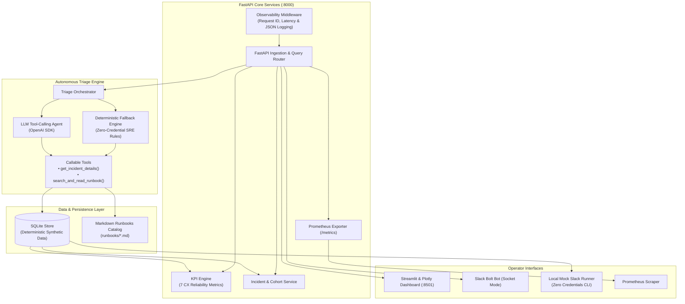
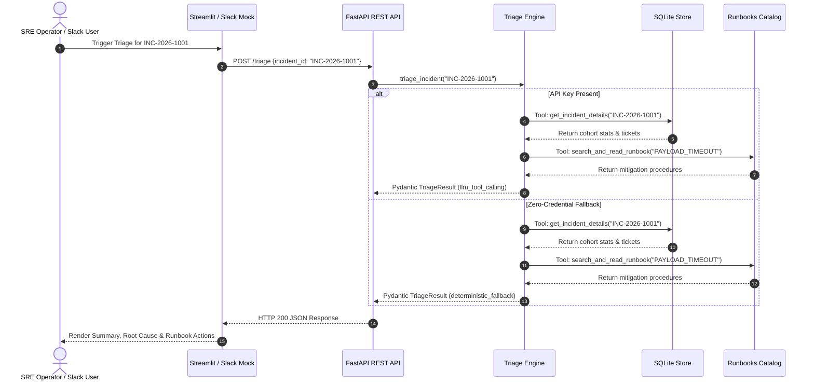

# SyncOps Assistant: System Architecture & Technical Design

> **SYNTHETIC DISCLOSURE:** SyncOps Assistant is an independent educational SRE and customer-experience reliability platform. All data, telemetry, and incident scenarios are deterministically generated. No connection or affiliation with Apple or any other enterprise is claimed or implied.

---

## 1. High-Level System Architecture

SyncOps Assistant connects synthetic client telemetry, incident tracking, REST API services, an interactive dashboard, and an autonomous LLM triage agent with deterministic fallback:

---

## 2. Component Design & Responsibilities

### 2.1 Synthetic Persistence Layer (`app/database.py`, `scripts/seed_data.py`)
- **Engine:** SQLite 3 with parameterized queries, WAL mode capability, foreign keys enforced (`PRAGMA foreign_keys = ON;`), and connection pooling via context managers.
- **Tables:**
  - `customers`: Client cohort assignments (`iOS-Production`, `Android-v3`, etc.), app versions, hardware models.
  - `sync_events`: 5,000+ granular sync attempts with duration, bytes, retry count, status, and failure category.
  - `incidents`: Severity (`SEV1`-`SEV4`), lifecycle status (`DETECTED`, `INVESTIGATING`, `MITIGATED`, `RESOLVED`), start/recovery timestamps, and cohort bindings.
  - `support_tickets`: Escalated customer tickets, resolution times, and self-service flags.
  - `adoption_records`: 30-day daily active users (DAU) and sync feature adoption counts.
- **Indexing Strategy:** B-tree indexes on `timestamp`, `status`, `customer_id`, `incident_id`, and `failure_category` guarantee sub-5ms query performance.

### 2.2 FastAPI REST Service Layer (`app/main.py`)
- Single source of truth for both the UI dashboard and automation bots.
- Strict request and response serialization with Pydantic v2 schemas.
- Non-blocking asynchronous middleware tracking HTTP request latency, status counts, and generating distributed trace request IDs (`X-Request-ID`).
- Endpoints:
  - `GET /health`: Database health and table record counts.
  - `GET /kpis`: Calculation of all 7 customer-experience reliability metrics.
  - `GET /incidents`: Queryable incident repository with validated severity, status, and pagination filters.
  - `GET /incidents/{incident_id}`: Detailed incident view with correlated cohort telemetry.
  - `POST /triage`: Autonomous SRE triage execution.
  - `GET /metrics`: Standard Prometheus metrics exposition format.

### 2.3 Streamlit & Plotly Operator Dashboard (`dashboard/app.py`)
- Real-time SRE monitoring interface querying the FastAPI backend via HTTP.
- Metric cards showing SLO deltas, sample sizes, and plain-English business context.
- Plotly charts displaying failure category distributions and severity breakdowns.
- Interactive incident drill-down enabling operators to trigger on-demand triage and view correlated runbook recommendations.

### 2.4 Autonomous Triage Engine (`app/triage/`)
- Executes the standard SRE triage framework: **Detect → Explain → Recover → Confirm**.
- **Real Tool-Calling Architecture:**
  1. `get_incident_details(incident_id)`: Fetches incident record, cohort failure percentage, latency, and customer tickets.
  2. `search_and_read_runbook(query_or_filename)`: Discovers and parses Markdown runbooks from `runbooks/`.
- **Hybrid Execution Flow:**
  - **Online Mode:** When `OPENAI_API_KEY` is provided, an OpenAI-compatible model iteratively invokes tools, receives real database and runbook outputs, and compiles a structured Pydantic assessment.
  - **Offline Deterministic Fallback Mode:** When API keys are absent, network fails, or fallback is forced, a rule-based SRE engine executes the exact same tools and correlates findings deterministically. Zero hallucination risk, completely offline, and reproducible.

### 2.5 Slack Integration Layer (`app/slack/`)
- **Production Mode (`bot.py`):** Slack Bolt for Python with Socket Mode listener, handling `/syncstatus`, `/incidents`, and `@SyncOps` mentions.
- **Mock Mode (`mock.py`):** Simulates all slash commands, app mentions, and threshold alert checks locally without network access, credentials, or paid workspaces.

---

## 3. End-to-End Incident Triage Flow

---

## 4. Failure Handling, Resiliency, & Observability

1. **Missing Data & Zero Denominators:** KPI computation guards against division-by-zero, returning descriptive sample size metadata.
2. **Graceful Fallback:** If the LLM provider fails, times out, or receives rate limits, the system seamlessly drops back to the deterministic SRE engine.
3. **Bounded Cardinality Metrics:** Prometheus labels are restricted to static strings (`method`, `endpoint`, `status_code`, `mode`). Arbitrary customer IDs or incident IDs are strictly prohibited in metrics.
4. **Structured JSON Logs:** All request logs contain timestamp, service name, request ID, duration, and status code, facilitating ingestion into Splunk, Datadog, or Grafana Loki.

---

## 5. Security & Isolation Boundaries

- **Secret Isolation:** API tokens, Slack keys, and database credentials are read exclusively from environment variables or `.env`. None are hardcoded or committed.
- **Synthetic Data Isolation:** All customer records use synthetic IDs (`CUST-0001` to `CUST-0300`), eliminating PII/GDPR concerns.
- **Read-Only Advisory AI:** The LLM triage agent has read-only tools. It cannot modify database records, terminate cloud resources, or alter production code autonomously. Human review is strictly enforced.
