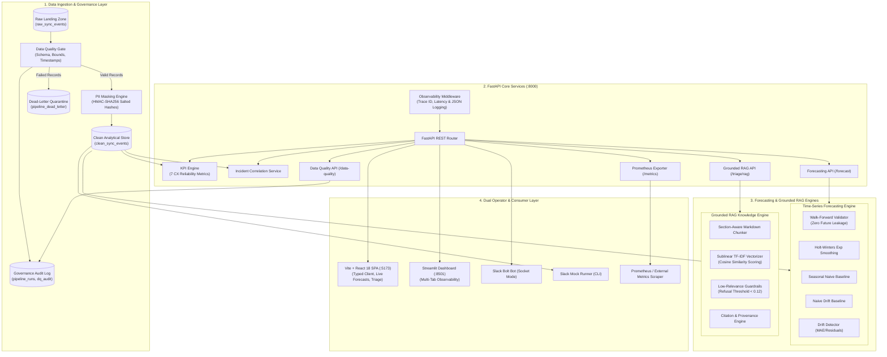
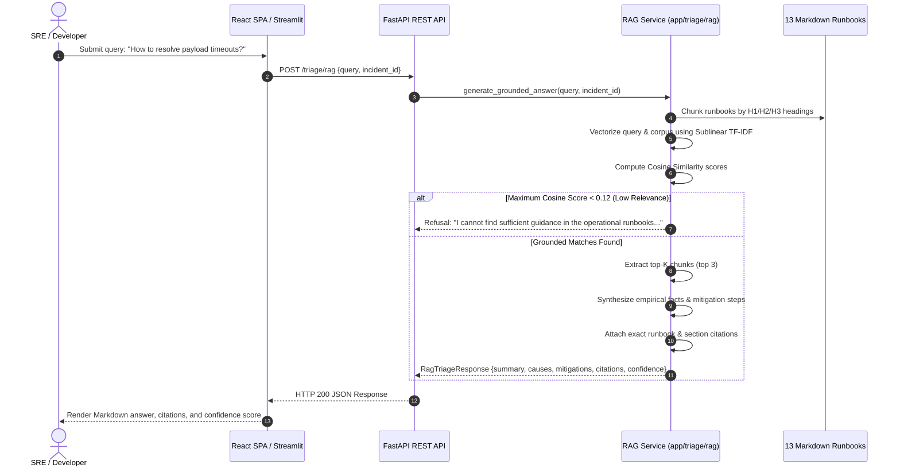

# SyncOps Assistant: System Architecture & Technical Design

> **SYNTHETIC DISCLOSURE:** SyncOps Assistant is an independent educational SRE, Data Engineering, and AI Reliability platform. All data, telemetry, customer profiles, and incident scenarios are deterministically generated. No connection or affiliation with any commercial enterprise is claimed or implied.

---

## 1. High-Level System Architecture

SyncOps Assistant connects end-to-end telemetry ingestion, an idempotent ETL data pipeline, data governance and PII masking, chronological time-series forecasting, an autonomous grounded RAG triage agent, Prometheus observability, and dual operator interfaces (Streamlit + Vite React):



---

## 2. End-to-End Data Pipeline & Lineage

The data pipeline enforces strict isolation between raw landing data, validated analytical records, and quarantined dead-letter records:

```
[External Devices / Synthetic Generator]
                │
                ▼
      raw_sync_events (Landing Layer)
                │
                ▼
   pipeline/validate.py (Data Quality Gate)
        ├── Failure ──► pipeline_dead_letter (Quarantine Layer)
        │
        └── Pass ────► pipeline/transform.py (HMAC-SHA256 PII Masking)
                              │
                              ▼
                     clean_sync_events (Clean Analytical Store)
                              │
               ┌──────────────┴──────────────┐
               ▼                             ▼
       app/kpis.py (7 CX KPIs)      forecasting/ (Time-Series Engine)
```

### Table Specifications:
- `raw_sync_events`: Immutable append-only landing zone. Captures payload size, latency, error strings, and device metadata.
- `clean_sync_events`: Analytical source of truth. Enforces deduplication via `fingerprint`, masks `customer_id` and `device_id` into cryptographic tokens (`cust_...`, `dev_...`), and guarantees non-negative latencies and valid status enums.
- `pipeline_dead_letter`: Records quarantined due to blocking data quality checks (e.g., negative duration, invalid status, missing customer identifier, future timestamps).
- `pipeline_runs`: Operational metadata recording run timestamp, record counts (total, accepted, rejected, duplicates skipped), and execution duration.
- `pipeline_dq_audit`: Individual validation check results, severity (`BLOCKING` vs `WARNING`), and pass/fail status.

---

## 3. Time-Series Forecasting Architecture

### 3.1 Validation Strategy
To avoid lookahead bias and temporal leakage, we evaluate models using **chronological walk-forward validation** (rolling origin):
- **Split:** Day $t$ is predicted using historical data strictly from days $[1, t-1]$.
- **Metrics Tracked:**
  - Mean Absolute Error ($\text{MAE} = \frac{1}{n} \sum |y_t - \hat{y}_t|$)
  - Root Mean Squared Error ($\text{RMSE} = \sqrt{\frac{1}{n} \sum (y_t - \hat{y}_t)^2}$)
  - Symmetric Mean Absolute Percentage Error ($\text{sMAPE} = \frac{100\%}{n} \sum \frac{2|y_t - \hat{y}_t|}{|y_t| + |\hat{y}_t| + \epsilon}$)

### 3.2 Candidate Models
1. **Holt-Winters Exponential Smoothing:** Captures level smoothing ($\alpha$), trend smoothing ($\beta$), and damped or additive trends using statsmodels.
2. **Seasonal Naive Baseline (7-Day):** Projects the exact value from the same day of the prior week ($\hat{y}_{t+h} = y_{t+h-7}$).
3. **Naive Baseline (Last Value):** Projects the most recent observed value into the horizon ($\hat{y}_{t+h} = y_t$).

### 3.3 Prediction Intervals
Prediction bounds are derived from empirical in-sample residual variance:
$$\hat{y}_{t+h} \pm z \cdot \sigma_e \cdot \sqrt{h}$$
where $z = 1.96$ for the 95% confidence interval, ensuring bounds strictly widen with horizon length $h$ and honor mathematical sanity constraints ($0\% \le \text{failure rate} \le 100\%$, $\text{lower bound} \le \text{point forecast} \le \text{upper bound}$).

---

## 4. Grounded RAG Knowledge Base Architecture



### 4.1 Section-Aware Markdown Chunker (`chunker.py`)
- Standard character splitters break operational steps across arbitrary sentence boundaries.
- Our chunker parses Markdown heading tokens (`#`, `##`, `###`), preserving complete procedural sections (e.g., `## Immediate Mitigation Procedures`, `### Escalation Criteria`) within a single chunk.
- Chunks include rich metadata: `runbook_file`, `section_heading`, `chunk_id`, and character length.

### 4.2 Retrieval & Guardrails (`retriever.py`, `answer.py`)
- Employs sublinear term-frequency TF-IDF with cosine similarity from `scikit-learn`.
- Returns genuine cosine similarity scores in range $[0.0, 1.0]$.
- **Guardrail Enforcement:** Queries scoring below $0.12$ trigger an immediate safety refusal, preventing hallucinated advice on out-of-scope queries (e.g. "How to bake a cake").
- **Strict Citations:** Every recommended action is directly attributed to its originating runbook file and section heading.

---

## 5. Dual Frontend Architecture

1. **Vite + React 18 TypeScript SPA (`frontend/`):**
   - Built for high responsiveness and modular UI component development.
   - Fully typed TypeScript API client (`api.ts`).
   - Components: `KPICards`, `IncidentTable`, `ForecastChart`, `DataQualityPanel`, `TriageChat`.
   - Served via multi-stage Docker build with Nginx on port 5173.
2. **Streamlit & Plotly Dashboard (`dashboard/app.py`):**
   - Rapid observability interface for Python data scientists and SREs.
   - Tabs: Incidents & Triage, Time-Series Forecasting, Data Quality & Governance, Grounded RAG Assistant.
   - Direct integration with FastAPI backend on port 8501.

---

## 6. Observability & SRE Middleware

- **Structured JSON Logging:** All incoming requests, background tasks, and triage runs emit machine-readable JSON logs with ISO-8601 timestamps, logger names, latency durations, and unique `X-Request-ID` trace identifiers.
- **Prometheus Metrics:** Native `/metrics` endpoint exports HTTP traffic counts, latency histograms, error rates, synthetic sync success rate gauges, and triage mode counters. Bounded label cardinality guarantees zero memory leak risk.
