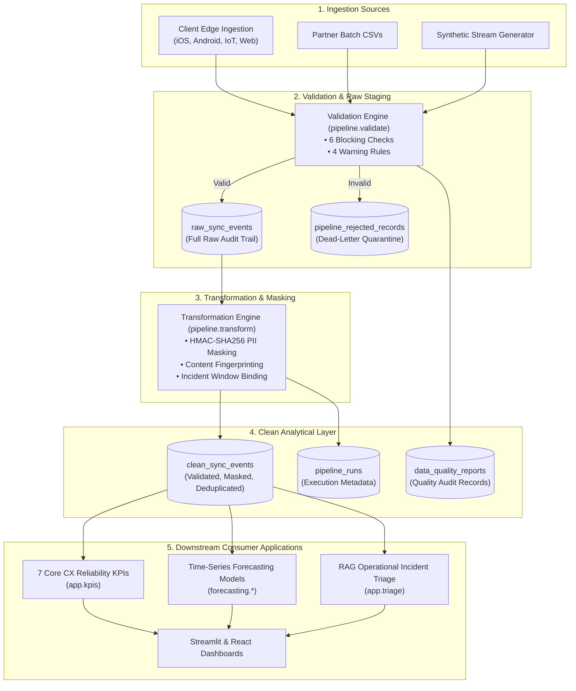

# SyncOps Assistant: Data Governance, Lineage & Quality Catalog

> [!IMPORTANT]
> ### ⚠️ GOVERNANCE & POLICY DISCLAIMER
> **ALL POLICIES, OWNERSHIP ASSIGNMENTS, RETENTION SCHEDULES, CLASSIFICATIONS, AND ACCESS TIERS DESCRIBED HEREIN ARE STRICTLY ILLUSTRATIVE — NOT REAL COMPANY POLICY. THEY DEMONSTRATE ENTERPRISE DATA GOVERNANCE PRINCIPLES FOR AN SRE AND DATA PLATFORM PORTFOLIO PROJECT.**

---

## 1. Enterprise Data Dictionary & Schema Definitions

### 1.1 Ingestion & Staging Layer (`raw_sync_events`)
The raw ingestion layer captures telemetry payloads directly from edge ingestion gateways without transformation.

| Column | Type | Nullable | Classification | Description | Illustrative Owner |
| :--- | :--- | :--- | :--- | :--- | :--- |
| `id` | `TEXT` | No | Internal Operational | Unique event identifier (`EVT-...`). | Ingestion SRE Team |
| `run_id` | `TEXT` | No | Pipeline Metadata | Ingestion batch execution identifier. | Data Platform Team |
| `customer_id` | `TEXT` | No | **Pseudonym Target** | Raw client customer identifier (`CUST-...`). | Identity Platform Team |
| `timestamp` | `TEXT` | No | Operational Telemetry | ISO-8601 UTC timestamp of client sync attempt. | Ingestion SRE Team |
| `status` | `TEXT` | No | Operational Telemetry | Outcome: `SUCCESS` or `FAILURE`. | Ingestion SRE Team |
| `failure_category`| `TEXT` | Yes | Operational Diagnostic| Specific failure reason (e.g. `PAYLOAD_TIMEOUT`). | Ingestion SRE Team |
| `latency_ms` | `REAL` | No | Performance Metric | Total round-trip synchronization latency. | Network SRE Team |
| `payload_size_bytes`| `INTEGER`| No | Resource Metric | Raw payload size transferred in bytes. | Storage Platform Team |
| `retry_count` | `INTEGER`| No | Reliability Metric | Client retry attempt count (0 for initial). | Client SDK Team |
| `raw_json` | `TEXT` | No | Audit Trail | Complete raw unparsed JSON payload. | Data Platform Team |
| `ingested_at` | `TEXT` | No | Pipeline Metadata | UTC timestamp when staged into SQLite. | Data Platform Team |

---

### 1.2 Analytical & Clean Layer (`clean_sync_events`)
The clean analytical layer enforces schema conformity, timestamp sanity, deduplication, and PII pseudonymization.

| Column | Type | Nullable | Classification | Description | Masking Applied |
| :--- | :--- | :--- | :--- | :--- | :--- |
| `id` | `TEXT (PK)` | No | Internal Key | Primary key for synchronization event. | None (Synthetic ID) |
| `customer_id_masked`| `TEXT` | No | **Pseudonymized Identifier**| HMAC-SHA256 salted hash of customer identifier (`MASK-...`). | HMAC-SHA256 Salted Hash |
| `timestamp` | `TEXT` | No | Standardized UTC | Verified ISO-8601 UTC timestamp. | None |
| `date` | `TEXT` | No | Partition Key | Standardized date string (`YYYY-MM-DD`). | Derived Key |
| `status` | `TEXT` | No | Normalized Outcome | Validated outcome: `SUCCESS` or `FAILURE`. | Normalized |
| `failure_category`| `TEXT` | Yes | Standardized Category| Validated failure category enum. | Normalized |
| `latency_ms` | `REAL` | No | Cleaned Metric | Validated non-negative latency in milliseconds. | None |
| `payload_size_bytes`| `INTEGER`| No | Cleaned Metric | Validated non-negative size in bytes. | None |
| `retry_count` | `INTEGER`| No | Cleaned Metric | Non-negative integer retry count. | None |
| `is_incident_window`| `INTEGER`| No | Derived Feature | Binary flag (0/1) indicating active incident. | Derived Feature |
| `fingerprint` | `TEXT` | No | Pipeline Hash | SHA-256 content fingerprint for deduplication. | SHA-256 Hash |
| `run_id` | `TEXT` | No | Lineage Tag | References `pipeline_runs.run_id`. | Foreign Lineage |
| `ingested_at` | `TEXT` | No | Lineage Tag | UTC timestamp of analytical promotion. | Audit Timestamp |

---

## 2. End-to-End Data Lineage

---

## 3. PII Masking & Pseudonymization Strategy

### Cryptographic Method
- **Algorithm:** `HMAC-SHA256` using `hashlib` and `hmac`.
- **Key Source:** Loaded dynamically from the `PII_SALT` or `PII_HMAC_KEY` environment variable.
- **Output Format:** Hexadecimal digest truncated to 16 characters with prefix: `MASK-{digest[:16]}`.
- **Isolation Boundary:**
  - Raw customer identifiers (`CUST-0001`) are quarantined strictly in `raw_sync_events`.
  - Analytical consumers (KPI calculations, time-series forecasting, Streamlit, and React frontends) only ever receive `customer_id_masked`.

### Known Privacy Limitations & Re-identification Risk
1. **Pseudonymization vs Anonymization:** Deterministic hashing is pseudonymization, NOT true anonymization. If an adversary discovers the customer identifier pattern (e.g., `CUST-0001` through `CUST-0300`), they could run a dictionary attack to invert the hashes if the salt is weak or compromised.
2. **Linkability:** Because the mapping is deterministic within a given salt scope, customer event sequences remain linkable over time for longitudinal cohort analysis.
3. **Operational Recommendation:** In production enterprise environments, rotate HMAC keys periodically and enforce strict role-based access control (RBAC) preventing analytical users from accessing the raw staging tables.

---

## 4. Data Quality Enforcement Points & Classification

| Check Category | Rule Code | Condition | Severity | Action on Violation |
| :--- | :--- | :--- | :--- | :--- |
| **Completeness** | `MISSING_REQUIRED_FIELD` | `id`, `customer_id`, `timestamp`, `status`, `latency_ms`, or `payload_size_bytes` is null/empty. | **BLOCKING** | Record rejected into `pipeline_rejected_records`. |
| **Integrity** | `INVALID_STATUS_VALUE` | `status NOT IN ('SUCCESS', 'FAILURE')`. | **BLOCKING** | Record rejected; cannot enter clean layer. |
| **Validity** | `NEGATIVE_METRIC` | `latency_ms < 0` or `payload_size_bytes < 0`. | **BLOCKING** | Record rejected. |
| **Temporality** | `FUTURE_TIMESTAMP_VIOLATION` | `timestamp > now() + 3600s` (exceeds 1-hour clock skew tolerance). | **BLOCKING** | Record rejected; prevents downstream timeseries distortion. |
| **Performance** | `HIGH_LATENCY_WARNING` | `latency_ms > 10,000ms`. | **WARNING** | Accepted into clean layer; flagged in data quality report. |
| **Retry Storm** | `HIGH_RETRY_COUNT_WARNING`| `retry_count > 5`. | **WARNING** | Accepted into clean layer; flagged as anomaly. |
| **Classification**| `FAILURE_WITHOUT_CATEGORY` | `status == 'FAILURE'` and `failure_category IS NULL`. | **WARNING** | Accepted; category imputed as `UNKNOWN_FAILURE`. |

---

## 5. Retention Assumptions & Access Control (Illustrative)

- **Raw Ingestion Staging (`raw_sync_events`):** Retained for 90 days for forensic troubleshooting and audit reconciliation; restricted to Platform SRE on-call engineers.
- **Clean Analytical Layer (`clean_sync_events`):** Retained for 365 days partitioned by date for KPI tracking and predictive forecasting; accessible to analytical applications.
- **Dead-Letter Staging (`pipeline_rejected_records`):** Retained for 30 days for data provider feedback loops.
- **Governance Audit Reports (`data_quality_reports`):** Retained indefinitely for compliance tracking.
