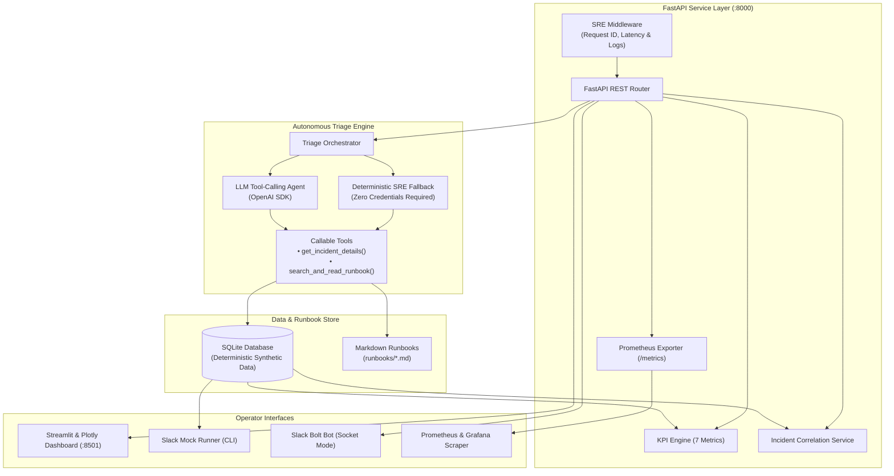

# SyncOps Assistant: Customer-Experience Reliability & SRE Triage Platform

> [!IMPORTANT]
> ### ⚠️ SYNTHETIC DATA DISCLOSURE
> **ALL DATA, TELEMETRY, LOGS, INCIDENT IDENTIFIERS, AND METRIC READINGS IN THIS REPOSITORY ARE 100% DETERMINISTICALLY GENERATED SYNTHETIC DATA CREATED FOR EDUCATIONAL RELIABILITY ENGINEERING DEMONSTRATION.**
> This project is an independent educational portfolio project and does NOT contain real customer data, internal corporate infrastructure, proprietary telemetry, or non-public information from Apple, Noise, or any other commercial organization.

---

## 1. Problem Statement
High-scale consumer synchronization platforms process millions of payload events across heterogeneous device fleets (iOS, Android, IoT sensors, web clients). When edge ingestion degradation or token invalidation surges occur, Site Reliability Engineers (SREs) face distinct challenges:
- **Alert Fatigue & Delayed MTTR:** Sifting through raw ingestion errors across millions of records delays mean time to identify and mitigate customer-impacting regressions.
- **Disconnection Between Telemetry and Runbooks:** Critical operational mitigation procedures are often trapped in static wikis disconnected from live database telemetry.
- **Unverified AI Triage:** Ad-hoc LLM chat tools often hallucinate non-existent database telemetry and lack verifiable integration with production databases.

## 2. Project Goals
**SyncOps Assistant** bridges the gap between customer-experience reliability monitoring and automated SRE incident investigation through a unified 4-stage operational workflow:

$$\text{Detect} \longrightarrow \text{Explain} \longrightarrow \text{Recover} \longrightarrow \text{Confirm}$$

1. **Automate Continuous Telemetry Monitoring:** Calculate 7 customer-experience KPIs over continuous time windows.
2. **Standardize SRE Operational Runbooks:** Provide actionable Markdown runbooks covering synchronization failures, authentication errors, firmware drops, and recovery protocols.
3. **Autonomous Verifiable Incident Triage:** Implement genuine LLM tool-calling that inspects SQLite database records and cross-references Markdown runbooks, backed by a 100% deterministic offline fallback engine.
4. **Zero-Friction Beginner Experience:** Run the entire platform locally on Windows without any paid API keys, Slack workspaces, or cloud subscriptions.

---

## 3. Architecture Diagram



---

## 4. Component Descriptions

| Component | Technology | File Location | Responsibility |
| :--- | :--- | :--- | :--- |
| **REST API** | FastAPI, Pydantic v2, Uvicorn | `app/main.py` | Exposes `/health`, `/kpis`, `/incidents`, `/triage`, and `/metrics`. |
| **KPI Engine** | Python, SQLite SQL | `app/kpis.py` | Computes 7 customer-experience reliability metrics with zero-division protection. |
| **Data Layer** | SQLite 3 | `app/database.py`, `scripts/seed_data.py` | Deterministic synthetic schema with 300 customers, 5,000 sync events, and incidents. |
| **Dashboard** | Streamlit, Plotly | `dashboard/app.py` | Real-time SRE telemetry dashboard with interactive incident triage viewer. |
| **Slack Bot** | Slack Bolt for Python | `app/slack/bot.py` | Real Slack Bolt application with Socket Mode support and threshold alert checks. |
| **Slack Mock** | Python CLI | `app/slack/mock.py` | Zero-credential local simulator for slash commands and app mentions. |
| **Triage Agent** | OpenAI SDK, Function Calling | `app/triage/agent.py` | Autonomous multi-turn agent with real database and runbook inspection tools. |
| **Deterministic Fallback** | Pure Python SRE Engine | `app/triage/fallback.py` | Offline, reproducible rule-based incident investigation matching LLM schema. |
| **Observability** | Prometheus Client, JSON Logs | `app/metrics.py`, `app/logging_config.py` | Bounded-cardinality metrics and structured request logging. |

---

## 5. Synthetic Data Model

```
customers (id, cohort, created_at, device_type, app_version)
    │
    ├──< sync_events (id, customer_id, timestamp, status, failure_category, latency_ms, payload_size_bytes, retry_count)
    │
    └──< support_tickets (id, customer_id, incident_id, timestamp, category, resolved_via_self_service, resolution_time_minutes)

incidents (id, title, severity, status, start_time, recovery_time, affected_cohort, failure_category, root_cause_summary)

adoption_records (date, daily_active_users, total_registered_users, sync_feature_adopted_users)
```

- **Idempotent Seeder:** Running `python scripts/seed_data.py` populates missing records without duplicating existing data.
- **Explicit Reset:** `python scripts/seed_data.py --reset` safely purges and re-seeds tables.

---

## 6. Seven Customer-Experience KPIs

| KPI Name | Formula | Window | Units | CX / SRE Significance |
| :--- | :--- | :--- | :--- | :--- |
| **1. Sync Success Rate** | $\frac{\text{Successful Sync Events}}{\text{Total Sync Attempts}} \times 100$ | 24h / Filterable | `%` | Core Service Level Indicator (SLI) measuring customer telemetry data continuity. |
| **2. Recovery Rate** | $\frac{\text{Mitigated or Resolved Incidents}}{\text{Total Incidents}} \times 100$ | 24h / All-time | `%` | Evaluates engineering operational efficacy in restoring platform health. |
| **3. Time to Recover (MTTR)** | $\frac{\sum (\text{Recovery Time} - \text{Start Time})}{\text{Resolved Incidents Count}}$ | Incidents with recovery | `Minutes` | Directly quantifies the average duration customers experience service degradation. |
| **4. Repeat Failure Rate** | $\frac{\text{Customers with } > 1 \text{ Failure}}{\text{Customers with } \ge 1 \text{ Failure}} \times 100$ | 24h / Filterable | `%` | Pinpoints sticky client degradation and chronic synchronization loops. |
| **5. Sync Support Tickets** | $\text{Count of sync tickets} \text{ and } \frac{\text{Tickets}}{\text{Total Failures}} \times 100$ | 24h / Filterable | `Count` & `%` | Quantifies customer support escalation volume and ticket-to-failure conversion ratio. |
| **6. Self-Service Resolution Rate**| $\frac{\text{Self-Service Resolved Tickets}}{\text{Total Support Tickets}} \times 100$ | 24h / Filterable | `%` | Measures customer friction reduction through automated in-app troubleshooting guides. |
| **7. Sync Feature Adoption Rate** | $\frac{\text{Sync Active Users (Daily)}}{\text{Daily Active Users (DAU)}} \times 100$ | Daily snapshot | `%` | Tracks long-term customer engagement and feature adoption across the fleet. |

---

## 7. Technology Stack & Design Rationale

- **FastAPI:** High-performance asynchronous REST framework with native OpenAPI/Swagger docs and strict Pydantic v2 validation.
- **SQLite 3:** Zero-configuration, file-based relational store with full SQL capabilities, ACID guarantees, and zero cloud hosting dependencies.
- **Streamlit & Plotly:** Rapid, expressive SRE dashboard development with dynamic charting and seamless Python state management.
- **Slack Bolt:** Industry standard SDK for Slack integrations, supporting secure Socket Mode without exposing public webhooks.
- **Prometheus Client:** Production standard metrics exposition (`/metrics`) using bounded cardinality labels to prevent memory leaks.
- **OpenAI Tool-Calling SDK:** Real function calling architecture providing bi-directional tool invocation, paired with an offline fallback.

---

## 8. Prerequisites & Windows PowerShell Setup

### Prerequisites
- Python 3.10+ (Verified on Python 3.12.10)
- Git (Verified on Git 2.56.0)
- Windows PowerShell 5.1 or PowerShell 7+

### Automated Setup (One Command)
Clone or navigate to the project directory and run:

```powershell
# Run the automated PowerShell setup script
.\setup.ps1
```

Or manually execute the standard Python setup:

```powershell
# 1. Create and activate virtual environment
python -m venv .venv
.venv\Scripts\Activate.ps1

# 2. Upgrade pip and install dependencies
pip install --upgrade pip
pip install -r requirements.txt

# 3. Seed synthetic database idempotently
python scripts/seed_data.py

# 4. Run automated test suite
pytest -v
```

---

## 9. Running the Application (Windows PowerShell)

Open separate PowerShell terminal windows for each service:

### Terminal 1: FastAPI REST API
```powershell
.venv\Scripts\Activate.ps1
uvicorn app.main:app --reload --port 8000
```
- Interactive Swagger UI: `http://localhost:8000/docs`
- Prometheus Metrics: `http://localhost:8000/metrics`

### Terminal 2: Streamlit Reliability Dashboard
```powershell
.venv\Scripts\Activate.ps1
streamlit run dashboard/app.py --server.port 8501
```
- Open browser at: `http://localhost:8501`

### Terminal 3: Local Slack Mock Mode (Zero Credentials)
```powershell
.venv\Scripts\Activate.ps1
python -m app.slack.mock
```

---

## 10. API Endpoint Reference & Examples

### Health Check
```powershell
Invoke-RestMethod -Uri "http://localhost:8000/health" | ConvertTo-Json
```
```json
{
  "status": "healthy",
  "database_connected": true,
  "record_counts": {
    "customers": 300,
    "sync_events": 5000,
    "incidents": 5,
    "support_tickets": 244,
    "adoption_records": 31
  },
  "timestamp": "2026-10-23T01:19:54.000000Z",
  "disclosure": "ALL TELEMETRY IS SYNTHETIC FOR EDUCATIONAL USE"
}
```

### 7 CX KPIs (24-Hour Window)
```powershell
Invoke-RestMethod -Uri "http://localhost:8000/kpis?window_hours=24" | ConvertTo-Json -Depth 3
```

### Query Incidents by Severity
```powershell
Invoke-RestMethod -Uri "http://localhost:8000/incidents?severity=SEV1" | ConvertTo-Json
```

### Trigger Autonomous Incident Triage
```powershell
$body = @{ incident_id = "INC-2026-1001"; force_fallback = $true } | ConvertTo-Json
Invoke-RestMethod -Uri "http://localhost:8000/triage" -Method Post -ContentType "application/json" -Body $body | ConvertTo-Json
```

---

## 11. Streamlit Dashboard Guide

1. **Synthetic Data Disclosure Header:** Prominently displays the educational synthetic flag and current SRE phase.
2. **Top Metric Cards:** 7 KPI cards indicating real-time values, SLO deltas, and sample sizes.
3. **Failure Analytics:** Plotly bar chart displaying failure categories (`PAYLOAD_TIMEOUT`, `RATE_LIMITED`, `AUTH_EXPIRED`, etc.) and severity distribution.
4. **Interactive Triage Station:**
   - Select any incident from the active directory.
   - Inspect cohort telemetry (`iOS-Production`, `Android-v3`, etc.).
   - Click **"Run SRE Incident Triage"** to generate instant root-cause analysis and view actionable runbook links.

---

## 12. Local Mock Slack Runner (No Credentials Required)

The local mock runner (`app/slack/mock.py`) simulates the complete Slack experience without requiring external workspace configuration:

```powershell
python -m app.slack.mock
```

Output showcases:
1. **`/syncstatus`**: Formatted Slack Block Kit message with all 7 KPIs.
2. **`/incidents`**: Formatted incident list with status and severity emoji indicators.
3. **App Mention (`@SyncOps triage INC-2026-1001`)**: Automated triage assessment with root cause and runbook references.
4. **Threshold Alert Simulation**: Evaluates failure rate against threshold (e.g. 5%) and validates alert cooldown logic.

---

## 13. Production Slack Setup (Optional)

If connecting to a real Slack workspace:
1. Create a Slack App at `api.slack.com/apps`.
2. Enable **Socket Mode** and generate an App-Level Token (`xapp-...`) with `connections:write` scope.
3. Add Bot Token Scopes under **OAuth & Permissions**:
   - `commands`
   - `chat:write`
   - `app_mentions:read`
4. Create Slash Commands:
   - `/syncstatus`
   - `/incidents`
5. Enable **Event Subscriptions** and subscribe to `app_mention`.
6. Copy credentials to `.env`:
   ```bash
   SLACK_BOT_TOKEN=xoxb-...
   SLACK_APP_TOKEN=xapp-...
   SLACK_SIGNING_SECRET=...
   ```
7. Launch Slack Socket Mode listener:
   ```powershell
   python -m app.slack.bot
   ```

---

## 14. LLM Triage Configuration & Fallback Mode

SyncOps Assistant features a hybrid AI architecture:
- **Zero-Credential Fallback (Default):** Runs completely offline using `app/triage/fallback.py`. Queries SQLite database tools and correlates findings with Markdown runbooks deterministically.
- **OpenAI Tool-Calling (Optional):** Set `OPENAI_API_KEY` in `.env`. The agent invokes `get_incident_details` and `search_and_read_runbook` via OpenAI function calling, validating the final structured response with Pydantic.

```bash
# Optional .env configuration
LLM_PROVIDER=openai
OPENAI_API_KEY=sk-your-key-here
OPENAI_MODEL=gpt-4o-mini
```

---

## 15. Automated Test Suite

Run the full pytest suite:

```powershell
.venv\Scripts\pytest -v
```

The 49 unit and integration tests validate:
- All 7 KPI mathematical calculations and zero-denominator safety.
- FastAPI REST endpoints, status codes, 404s, and 422 validations.
- Parameterized incident queries and cohort telemetry correlation.
- Pydantic schema validation for triage results.
- Runbook file discovery and content integrity.
- Slack mock slash commands, app mentions, and alert cooldown enforcement.

---

## 16. Docker & Container Deployment

### Build and Run with Docker Compose
```bash
docker compose up --build -d
```
- API accessible at `http://localhost:8000`
- Dashboard accessible at `http://localhost:8501`
- Persistent SQLite database mounted on volume `syncops-data`.

### Verify Container Status
```bash
docker compose ps
docker compose logs -f
```

---

## 17. Prometheus Metrics & Observability

Prometheus metrics are exposed at `GET /metrics`:
- `syncops_http_requests_total`: Request counts labeled by `method`, `endpoint`, and `status_code`.
- `syncops_http_request_duration_seconds`: Histogram measuring endpoint latency.
- `syncops_http_errors_total`: 4xx and 5xx error counter.
- `syncops_synthetic_sync_success_rate`: Gauge tracking current sync success rate.
- `syncops_triage_operations_total`: Triage invocations labeled by `mode` and `outcome`.

**Grafana Integration:** Point Prometheus to `http://api:8000/metrics` and visualize latency p95, error budgets, and sync success rates against SLOs.

---

## 18. Screenshots & Visual Interface Walkthrough
Refer to [screenshots/README.md](file:///C:/Users/ASUS/.gemini/antigravity/scratch/syncops-assistant/screenshots/README.md) for step-by-step instructions on capturing manual screenshots of the dashboard, Plotly charts, triage cards, and Slack mock output.

---

## 19. System Limitations

1. **Synthetic Telemetry:** Data is deterministically generated to model failure patterns and does not capture unpredictable real-world distributed network anomalies.
2. **Single SQLite Database File:** Designed for lightweight single-host execution; high-write multi-region deployments would require PostgreSQL or distributed Cassandra/Spanner storage.
3. **Advisory AI Boundaries:** The triage agent is strictly read-only and advisory. Production configuration mutations or container restarts require human operator execution.

---

## 20. Security Considerations

- **Secret Zero-Exposure:** No API keys, tokens, or private secrets are committed to Git. All secrets are loaded through `.env` (excluded via `.gitignore`).
- **Bounded Tool Cardinality:** Tools accept strictly validated primitive inputs (`incident_id: str`, `query: str`) preventing SQL injection or directory traversal.
- **No PII:** Customer IDs and device identifiers are anonymized synthetic representations.

---

## 21. Troubleshooting Guide

| Issue | Cause | Solution |
| :--- | :--- | :--- |
| `Dashboard shows connection error` | FastAPI API server is not running on port 8000. | Run `uvicorn app.main:app --port 8000` in a separate terminal. |
| `UnicodeEncodeError on Windows` | Default PowerShell codepage encoding limitation. | Handled automatically via UTF-8 reconfigure in scripts, or run `chcp 65001`. |
| `Slack credentials warning` | Missing Slack tokens in `.env`. | Normal behavior. Use `python -m app.slack.mock` for zero-credential local mock mode. |
| `LLM provider timeout` | Network latency or invalid API key. | The system automatically falls back to deterministic SRE triage without crashing. |

---

## 22. Future Improvements
- Add WebSocket support for real-time live ingestion streaming directly to the dashboard.
- Introduce vector similarity search for runbook retrieval across hundreds of documentation pages.
- Add an automated Canary Analysis module evaluating progressive deployment failure rates.

---

## 23. Independent Project & Synthetic Data Disclaimer
This software is developed independently for educational purposes, portfolio demonstration, and SRE skills evaluation. It is not an official product of Apple, Noise, or any employer. All trademarks and company names are used strictly for context.
