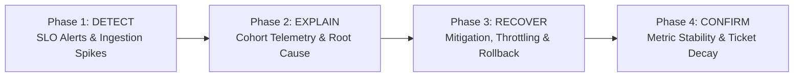

# SyncOps Assistant: SRE Operational Master Runbook

> **SYNTHETIC DISCLOSURE:** All procedures, alerts, cohorts, and metric thresholds are designed for educational Site Reliability Engineering training and portfolio demonstration. No proprietary corporate systems or private data are involved.

---

## 1. On-Call Incident Response Principles
As an SRE on-call for data platform synchronization pipelines, follow the 4-phase incident lifecycle:



1. **Protect Customer Experience First:** Prioritize restoring customer sync operations before performing in-depth root cause post-mortems.
2. **Distinguish Observation from Hypothesis:** Telemetry (error codes, latency percentiles, cohort distributions) is empirical fact; proposed failure mechanisms are hypotheses requiring validation.
3. **Advisory AI Assistance:** Use the automated triage agent to quickly surface correlated runbooks and logs, but always verify recommendations with operational domain knowledge before acting.

---

## 2. Severity Classification Matrix

| Severity | Customer Impact | SLO / Metric Threshold | Target Response | Target MTTR |
| :--- | :--- | :--- | :--- | :--- |
| **SEV1** | Global or multi-cohort outage | Sync Success Rate < 90% | Immediate (15m) | < 60 mins |
| **SEV2** | Single cohort degraded or device sync blocked | Sync Success Rate < 95% or Cohort Failures > 25% | < 30 mins | < 120 mins |
| **SEV3** | Intermittent failures or token expiry surge | Elevated retries, latency p95 > 2500ms | < 2 hours | < 4 hours |
| **SEV4** | Minor schema warning, non-critical telemetry loss | Baseline sync operational; edge parser drop | Next business day | N/A |

---

## 3. Operational Runbook Catalog

| Failure Category | Primary Runbook | Common Triggers | Recommended Mitigation |
| :--- | :--- | :--- | :--- |
| `PAYLOAD_TIMEOUT` | [payload_timeout_guide.md](file:///C:/Users/ASUS/.gemini/antigravity/scratch/syncops-assistant/runbooks/payload_timeout_guide.md) | Client batch upload bursts, decompression buffer saturation | Scale ingress decompression workers; increase gateway timeout buffer to 10s. |
| `RATE_LIMITED` | [payload_timeout_guide.md](file:///C:/Users/ASUS/.gemini/antigravity/scratch/syncops-assistant/runbooks/payload_timeout_guide.md) | Concurrent enterprise sync or burst traffic exceeding token bucket | Adjust token-bucket refill rate; introduce client exponential retry jitter. |
| `AUTH_EXPIRED` | [authentication_errors.md](file:///C:/Users/ASUS/.gemini/antigravity/scratch/syncops-assistant/runbooks/authentication_errors.md) | IdP leaf certificate rotation, JWKS cache invalidation | Flush JWKS public key cache; enable temporary 15m clock-skew tolerance. |
| `FIRMWARE_UNSUPPORTED` | [firmware_update_failures.md](file:///C:/Users/ASUS/.gemini/antigravity/scratch/syncops-assistant/runbooks/firmware_update_failures.md) | BLE packet truncation, device MTU buffer overflow | Pause OTA firmware staging; enforce dynamic 128-byte payload chunking on gateway. |
| `SCHEMA_MISMATCH` | [sync_failures.md](file:///C:/Users/ASUS/.gemini/antigravity/scratch/syncops-assistant/runbooks/sync_failures.md) | Protobuf/JSON schema field deprecation | Roll back or deploy gateway backward-compatibility translation layer. |
| `DATABASE_LOCK` | [sync_failures.md](file:///C:/Users/ASUS/.gemini/antigravity/scratch/syncops-assistant/runbooks/sync_failures.md) | Long-running transactions on core sync database shards | Terminate blocking lock processes; optimize indexing on sync_events. |
| `RECOVERY_CONFIRMATION` | [recovery_confirmation.md](file:///C:/Users/ASUS/.gemini/antigravity/scratch/syncops-assistant/runbooks/recovery_confirmation.md) | Mandated 4-step protocol before closing any incident | Verify 30m SLO stability, cohort parity, support ticket decay, and metrics baseline. |

---

## 4. On-Call SRE Quick Commands (Windows PowerShell)

```powershell
# 1. Query Platform Health & 24h KPIs
Invoke-RestMethod -Uri "http://localhost:8000/kpis?window_hours=24"

# 2. List Active Investigating Incidents
Invoke-RestMethod -Uri "http://localhost:8000/incidents?status=INVESTIGATING"

# 3. Trigger SRE Triage Investigation for Incident
Invoke-RestMethod -Uri "http://localhost:8000/triage" -Method Post -ContentType "application/json" -Body '{"incident_id": "INC-2026-1001", "force_fallback": true}'

# 4. Check Prometheus Metrics Endpoint
Invoke-RestMethod -Uri "http://localhost:8000/metrics"

# 5. Run Local Slack Bot Health Command
.venv\Scripts\python -m app.slack.mock
```
